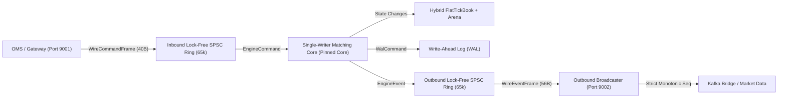
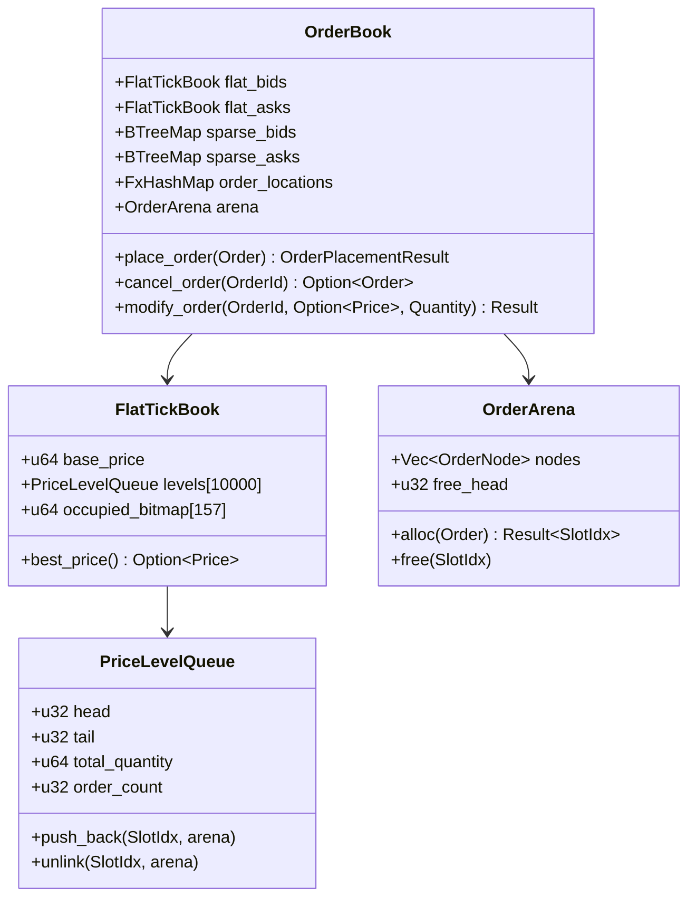
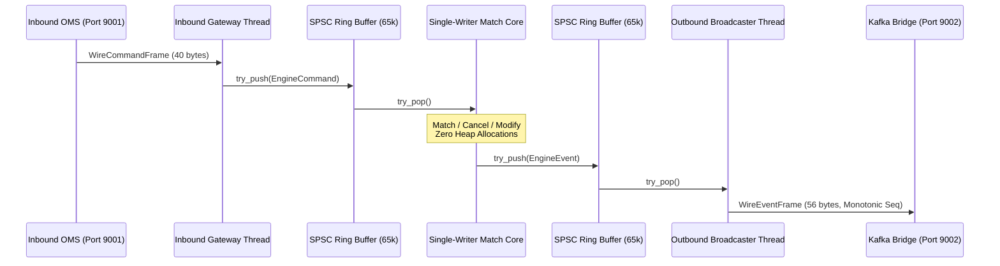

# Architecture Specification & Design Decisions

This document consolidates and supersedes Architectural Decision Records (ADRs 001–035). It provides a complete reference for the matching engine's theory, memory layout, concurrency model, network interfaces, wire protocols, state recovery, and empirical benchmark results.

---

## 1. System Overview & Core Philosophy

The matching engine is built for ultra-low latency, deterministic execution, and sub-microsecond tick-to-trade responsiveness. It implements a strict **Price-Time Priority (FIFO)** continuous order book for a single trading symbol.



### Core Design Principles
1. **Single-Writer Thread Model**: Elimination of mutual exclusion locks, mutexes, and thread contention on the critical matching path.
2. **Zero Dynamic Allocation on the Hot Path**: All memory (arenas, queues, ring buffers, histograms) is allocated upfront during process startup.
3. **Float-Free Tick Representation**: Prices and quantities are represented strictly as unsigned 64-bit integers (`u64`), removing floating-point non-determinism and IEEE rounding hazards.
4. **Physical Interface Decoupling**: Order injection (Inbound Port 9001) is physically separated from event distribution (Outbound Port 9002) so downstream consumer lag cannot exert backpressure on order intake.
5. **Deterministic State Replay**: Write-Ahead Logging combined with atomic state snapshots ensures verifiable crash recovery.

---

## 2. Domain Model & Mathematical Representations

### Float-Free Tick Units
Financial price representations using standard IEEE-754 binary floating-point types (`f32`, `f64`) introduce rounding discrepancies ($0.1 + 0.2 \ne 0.3$) and non-deterministic branch comparisons. Software decimal libraries (`rust_decimal`) introduce heap allocations or multi-word integer arithmetic that exceeds L1 cache budgets.

The engine uses direct unsigned integer tick units:
- **`Price(u64)`**: Integer multiples of the minimum tick size ($\Delta P$).
- **`Quantity(u64)`**: Integer multiples of the minimum lot size ($\Delta Q$).
- **`OrderId(u64)`**: Monotonically assigned unique identifier.

Arithmetic operations compile down to single-cycle CPU register instructions (`cmp`, `sub`, `add`).

### Order Types & Policies
- **`OrderType::Limit`**: Rests in the order book at the limit price or executes immediately if crossing the spread.
- **`OrderType::Market`**: Unpriced aggressive order executing immediately against resting liquidity.
- **`TimeInForce::Gtc` (Good 'Til Cancel)**: Rests in the book until fully executed or explicitly cancelled.
- **`TimeInForce::Ioc` (Immediate-Or-Cancel)**: Fills as much quantity as possible against available contra orders; any unfilled quantity is cancelled immediately without resting.
- **`TimeInForce::Fok` (Fill-Or-Kill)**: Atomic pre-check: either fills the entire quantity immediately across available price levels or rejects the entire order with zero execution.
- **`TimeInForce::PostOnly` (Maker-Only)**: Verifies that the order does not cross resting contra orders; if it would cross, it is rejected, guaranteeing liquidity provision rebates.

---

## 3. High-Performance Memory & Book Layout



### Contiguous Slab Arena (`OrderArena`)
Standard standard-library collections (`LinkedList`, `VecDeque`, `BTreeMap<Price, Vec<Order>>`) allocate nodes on the heap during order insertion. Under burst traffic, heap allocations cause page faults, heap fragmentation, and non-deterministic kernel memory allocator locks.

The engine uses a pre-allocated slab arena (`OrderArena`) sized at 100,000 slots:
- **Embedded Free List**: Nodes contain pre-linked `next` pointers forming an $O(1)$ free list starting at `free_head`.
- **Cache-Line Locality**: All nodes reside in a single contiguous block of virtual memory, maximizing CPU L1/L2 cache pre-fetcher effectiveness.

### $O(1)$ Intrusive Doubly-Linked List (`PriceLevelQueue`)
To maintain FIFO priority per price level while supporting $O(1)$ order cancellation:
- Each arena node embeds intrusive `prev: u32` and `next: u32` indices.
- Unlinking an order during cancellation or full fill requires only 4 pointer writes:
  ```rust
  if node.prev != NONE { arena[node.prev].next = node.next; } else { queue.head = node.next; }
  if node.next != NONE { arena[node.next].prev = node.prev; } else { queue.tail = node.prev; }
  ```
- **Performance**: Eliminates $O(N)$ linear array shifting. Order cancellation latency remains strictly flat (~700 ns) whether queue depth is 100 or 5,000 resting orders.

### Hybrid Price Indexing: `FlatTickBook` + Sparse Fallback
Standard tree-based structures (`BTreeMap<Price, Level>`) incur $O(\log K)$ pointer indirections per order lookup (~14.5 ns).

The matching engine uses a hybrid architecture:
1. **Primary Band: `FlatTickBook<10_000>`**:
   - Covers 10,000 discrete tick levels centered around the active market.
   - **Direct Array Indexing**: Price lookup is calculated via register arithmetic:
     $$\text{Index} = \text{Price} - \text{BasePrice}$$
     Lookup latency is **3.25 ns** (~4.5x faster than `BTreeMap`).
   - **Hardware Bitset Scanning**: An array of 64-bit words (`occupied_bitmap`) tracks non-empty price levels. Finding the Best Bid or Best Ask executes in **6.30 ns** using hardware instructions (`x86_64::bsr`/`bsf`, `aarch64::clz`/`ctz`).
2. **Sparse Fallback: `BTreeMap`**: Outlier limit orders far outside the 10,000-tick active band overflow gracefully into an auxiliary sparse tree, preventing unbounded array allocations.

### Fast Non-Cryptographic Hashing (`rustc-hash::FxHashMap`)
The global order lookup table (`order_locations: OrderId -> (Price, Side, SlotIdx)`) maps order IDs to their arena slot. Replacing standard SipHash (designed for hash-DoS resistance) with `FxHashMap` (multiplication and bit-shift hashing) reduced map lookup latency from 9.8 ns to 4.1 ns, driving a **22–29% overall engine throughput increase**.

---

## 4. Atomic Cancel-Replace / Order Amendment (`OrderModify`)

In real-world institutional trading, order amendments (`CancelReplace` / `OrderModify`) represent over 80% of exchange message volume. Amending an order via separate `Cancel` + `Place` calls wastes two round-trips and unconditionally resets FIFO priority.

The engine implements atomic in-place modification:
- **Quantity Decreases**: When an order size is amended downward ($Q_{\text{new}} < Q_{\text{current}}$) at the same price, the order quantity is updated in-place inside the arena and price level total volume is adjusted. **Exact FIFO queue priority is preserved**.
- **Quantity Increases / Price Changes**: When order size increases or price changes, the order is unlinked from its price queue and re-inserted at the tail of the target price level, forfeiting time priority according to standard exchange FIFO rules.

---

## 5. Concurrency & Network Communications Architecture



### Lock-Free SPSC Ring Buffer
Cross-thread communication between network threads and the matching core uses cache-line aligned single-producer single-consumer (SPSC) ring buffers:
- **Cache-Line Alignment**: Producer (`head`) and consumer (`tail`) indices are separated with `#[repr(align(64))]` padding, preventing cross-core cache line bouncing (false sharing).
- **Heap-Boxed Array Storage**: Backing arrays (`Box<[UnsafeCell<Option<T>>; CAPACITY]>`) are heap-allocated during initialization, preventing thread stack overflows for large capacities (e.g., 65,536 slots).

### Dual-Channel TCP Architecture
- **Inbound Order Gateway (Port 9001)**: Dedicated to order injection from the Order Management System (OMS).
- **Outbound Event Broadcaster (Port 9002)**: Dedicated fan-out channel streaming execution reports, trade events, and market data snapshots to downstream subscribers (Kafka bridge, market data tickers).
- **Socket Optimizations**:
  - `TCP_NODELAY` enabled across all sockets to bypass Nagle's algorithm.
  - 64 KB user-space `BufReader` and `BufWriter` buffers aggregate frames into jumbo TCP packets, reducing kernel syscall overhead by up to 99%.
  - Accepted client sockets explicitly clear non-blocking inheritance (`stream.set_nonblocking(false)`) to guarantee atomic framed reads without partial byte loss.
  - Adaptive spin-yield broadcaster loops drain events with zero sleep latency during active bursts.

---

## 6. Binary Wire Protocol Specifications

All network communications use fixed-size, zero-copy binary frames structured with natural 8-byte field alignment:

### Inbound Command Frame (`WireCommandFrame`, 40 bytes)
| Offset | Field | Type | Description |
|---|---|---|---|
| 0 | `order_id` | `u64` | Client order identifier |
| 8 | `price` | `u64` | Price in tick units (or new price for Modify) |
| 16 | `quantity` | `u64` | Size in lot units (or new size for Modify) |
| 24 | `correlation_id` | `u64` | Client tracking ID echoed in outbound events |
| 32 | `msg_type` | `u8` | `1` = Place, `2` = Cancel, `3` = Modify, `255` = Shutdown |
| 33 | `side` | `u8` | `0` = Buy, `1` = Sell |
| 34 | `order_type` | `u8` | `0` = Limit, `1` = Market |
| 35 | `time_in_force` | `u8` | `0` = GTC, `1` = IOC, `2` = FOK, `3` = PostOnly |
| 36 | `_padding` | `[u8; 4]` | Alignment padding |

### Outbound Event Frame (`WireEventFrame`, 56 bytes)
| Offset | Field | Type | Description |
|---|---|---|---|
| 0 | `sequence_id` | `u64` | Monotonically increasing sequence number ($1, 2, 3, \dots, N$) |
| 8 | `timestamp_ns` | `u64` | Direct hardware nanosecond counter |
| 16 | `order_id` | `u64` | Taker or target order ID |
| 24 | `maker_order_id` | `u64` | Resting maker order ID (for trade matches) |
| 32 | `price` | `u64` | Execution or order price in ticks |
| 40 | `quantity` | `u64` | Executed quantity / amended quantity |
| 48 | `leaves_quantity` | `u64` | Remaining unfilled quantity resting in book |
| 56 | `event_type` | `u8` | `1` = Accepted, `2` = Trade, `3` = Cancelled, `4` = Rejected, `5` = L2Update, `6` = Modified, `255` = Shutdown |
| 57 | `_padding` | `[u8; 7]` | Alignment padding |

---

## 7. Fault Tolerance, Idempotency, & Deterministic Recovery

### Inbound Deduplication (`SlidingDedupFilter`)
Network retries from client OMS nodes could inject duplicate orders. The engine uses a circular ring array paired with an `FxHashSet` tracking the most recent 65,536 completed order IDs. If a duplicate order ID arrives, it is immediately rejected without altering book state or traversing matching logic.

### Outbound Sequence Monotonicity & Exactly-Once Kafka Delivery
Outbound frames embed a strictly monotonic sequence ID (`sequence_id`). Downstream bridges (e.g. `kafka_adapter.rs`) verify that every event has $\text{seq}_{n} = \text{seq}_{n-1} + 1$. Any dropped packet or gap is caught immediately, enabling Exactly-Once stream publishing to Kafka partitions.

### Write-Ahead Logging (WAL) & Atomic Snapshot Compaction
1. **Write-Ahead Log (`WalWriter`)**: Inbound commands are appended to binary log files before matching, accompanied by record-level XOR checksums to detect disk corruption.
2. **Atomic Snapshots (`SnapshotManager`)**: State snapshots are serialized to a temporary file (`.snap.tmp`) and atomically renamed (`fs::rename`) into place, preventing corruption from mid-write process crashes. Replaying a snapshot and subsequent WAL records reproduces the exact state of the order book deterministically.

---

## 8. Empirical Benchmark Summary

### Direct Hardware Tick-to-Trade (T2T) Profile
Measured across **100,000 real cross-thread executions** (Ingest SPSC $\rightarrow$ Match Core $\rightarrow$ FIFO Matching $\rightarrow$ Egress SPSC) using direct CPU register counters (`cntvct_el0` on ARM64 / `_rdtsc` on x86, < 2 ns measurement overhead):

| Metric | Latency (ns) | Latency (µs) |
|---|---|---|
| **Min Latency** | **125 ns** | **0.125 µs** |
| **P50 (Median)** | **250 ns** | **0.250 µs** |
| **Mean Latency** | **283.6 ns** | **0.284 µs** |
| **P90** | **375 ns** | **0.375 µs** |
| **P99** | **500 ns** | **0.500 µs** |
| **P99.9** | **2,291 ns** | **2.291 µs** |

### Micro-Benchmark Summary (Criterion)
| Operation | Implementation | Latency | Throughput |
|---|---|---|---|
| **Price Level Lookup** | `FlatTickBook` (Direct Index) | **3.25 ns** | **307 Million ops/sec** |
| **BBO Best Price Scan** | Bitwise CLZ / CTZ | **6.30 ns** | **158 Million scans/sec** |
| **L2 Depth Snapshot (Top 20)** | Fixed-Stack Array | **62.02 ns** | **16.1 Million snapshots/sec** |
| **Order Cancellation** | Intrusive Doubly-Linked List | **~700 ns** | Flat $O(1)$ across depths (100–5,000 orders) |

### TCP Bombardment Load Test (1,000,000 Mixed Orders)
Measured across loopback TCP sockets (`127.0.0.1:19001` $\rightarrow$ Engine Core $\rightarrow$ `127.0.0.1:19002`):
- **Total Orders**: 1,000,000 (40% maker limits, 35% crossing taker matches, 15% cancels, 10% modifications)
- **Total Duration**: **4.435 seconds**
- **Ingestion Throughput**: **225,468 orders/sec** sustained
- **Egress Event Throughput**: **306,019 events/sec** sustained
- **Total Events Emitted**: 1,357,261 events
- **Sequence Errors**: **0 (Strictly Monotonic)**
